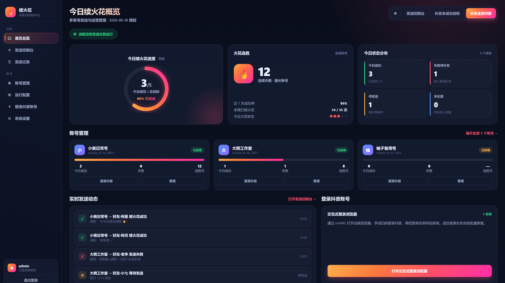

# 🔥 DouYin SparkFlow

**抖音普通聊天定时消息工具 · v0.1.0-beta.1 测试版**

支持本人授权账号管理、指定好友定时消息、扫码登录、发送记录和异常处理。通过普通抖音聊天页面操作；火花结果以抖音 App 为准。

[运行与排障](docs/OPERATIONS.md) · [发布说明](RELEASE_NOTES.md) · [验证范围](docs/RELEASE.md) · [反馈问题](https://github.com/J-A-D123/douyin-sparkflow/issues)

本仓库基于 [halfwaystudent/douyin-sparkflow](https://github.com/halfwaystudent/douyin-sparkflow) 继续修改。保留上游作者署名、[LICENSE](LICENSE)、[NOTICE](NOTICE.md) 和第三方许可。项目采用 **PolyForm Noncommercial 1.0.0**；本仓库并非抖音官方或获得平台授权的产品。

## 当前验证范围

- 2026-11-02 本机记录：2 个账号、3 个目标均有网页发送确认；新增账号成功也有用户反馈。
- 首条真实消息有本人明确的对方 App 收件确认；其服务器消息编号随后在独立上下文复核通过。
- 应用代码通过 176 项无账号隔离测试；本发布包只调整文档、项目地址及安装脚本的默认仓库地址。
- 尚未逐一核对全部收件方 App，也未完成 10 账号、跨日定时和连续七天无人值守验收。网页确认不能代替 App 收件或火花结果。

## 功能

- 独立账号资料、扫码登录和本人身份核验。
- 从普通聊天的现有会话选择目标；无法唯一核对的联系人停止发送。
- 默认北京时间每天 12:00，可在面板调整；固定计划恢复后补查当天一次。
- 保留草稿、发送前预约与同日去重；结果不明时保留待核验状态。
- 明确成功回执、服务器消息编号与独立历史复核；发送和复核浏览器顺序运行。
- Web 控制台提供账号、任务、记录和诊断。验证码及平台验证由本人完成。

## 快速开始

推荐 Docker Compose。需要 Git、Docker 和 Docker Compose；Docker 必须保持运行。

```sh
git clone https://github.com/J-A-D123/douyin-sparkflow.git
cd douyin-sparkflow
cp .env.example .env
bash ./deploy/install-local.sh
```

Windows PowerShell 可使用 `deploy/install-local.ps1`；不同系统的完整实机兼容性仍待验证。

打开管理页面 `http://localhost:8787`，按页面完成管理账号初始化/登录，再添加本人抖音账号，由本人完成扫码和手机验证并保存。

1. 刷新现有会话，明确选择好友并保存。没有会话的好友，先在抖音正常聊天中建立会话。
2. 设置文字与计划时间，先用一位双方同意的好友完成单条验收。
3. 核对对方 App 收件记录，再在首页启动自动任务。保存时间只保存计划，不代表调度服务已经启动。
4. 结果不明时先核对记录，再单独处理；已确认的目标不重复发送。

直接下载 ZIP 的用户，进入解压后的项目根目录，从 `cp .env.example .env` 开始即可。

## Mac 后台运行

可选辅助服务只在接电且调度运行时防止空闲休眠，屏幕可关闭：

```sh
python3 deploy/install-macos-keepawake.py install
python3 deploy/install-macos-keepawake.py status
```

它不会随源码包自动安装。合盖、退出登录、关机或 Docker 停止仍影响任务执行，详见[运行说明](docs/OPERATIONS.md)。

## 配置与资料

仓库提供 `.env.example`、`DouYinSparkFlow/config.example.json` 和 `proxy/config.example.yaml` 模板。运行时生成的 `.env`、账号、Cookie、浏览器资料、日志、内部令牌与订阅地址保留在本机，不随源码发布。

只操作本人拥有或明确获授权的账号，向明确选择的好友发送。平台要求验证码或安全验证时，由本人处理；明确拒绝、可见范围限制或不确定结果进入停止/待核验处理，不通过修改平台参数、重放请求或切换出口绕过限制。

## 测试与发布

`.github/workflows/ci.yml` 仅运行无账号测试，不读取账号 Secret，不执行真实发信任务，也不上传私人运行日志。GitHub CI 的 Python 多版本运行结果须以仓库 Actions 页面为准。

- [发布说明](RELEASE_NOTES.md)：此测试版的改进与边界。
- [发布与验收](docs/RELEASE.md)：测试步骤与长期验收项目。
- [回执格式](docs/RECEIPT_FORMAT.md)：响应字段、公开 SDK 来源及验证边界。
- [贡献说明](CONTRIBUTING.md)与[安全报告](SECURITY.md)。
- [更新日志](CHANGELOG.md)。

## 预览

以下为上游提供的界面示意，当前版本提示文字以实际界面为准。



## ⚠️ 免责声明


### 非官方项目声明

本项目为第三方个人项目，与抖音及其关联方不存在隶属、授权、代理、赞助、技术支持或合作关系。项目名称中出现的“抖音”仅用于说明兼容目标或使用场景，不代表任何官方认可。

### 使用授权与账号责任

- 使用者只能操作本人拥有或已获得明确授权的账号。
- 不得使用他人未经授权的账号、Cookies、登录态、身份凭据或个人信息。
- 使用者应自行判断使用本项目是否符合适用的法律法规、抖音用户协议及其他平台规则。

### 平台风险与责任限制

- 抖音可能随时调整服务、接口、页面、风控策略和用户协议。
- 自动化操作可能导致验证码、限流、功能限制、账号异常、账号封禁、登录态失效或其他平台处理。
- 本项目不保证平台兼容性、持续可用性、账号安全或任何特定功能结果，也不提供规避平台风控或绕过平台限制的保证。
- 在法律允许的最大范围内，作者不对因使用、修改、部署或运行本项目产生的账号处置、数据丢失、服务中断、隐私泄露、业务损失或其他损害承担责任；法律不得排除或限制的责任除外。

### 消息内容与数据责任

- 使用者对自动发送的消息内容、发送对象、发送频率以及由此产生的骚扰、侵权、违法或其他纠纷承担相应责任。
- 登录态、Cookies、账号信息、好友信息和发送记录可能属于敏感数据。使用者应自行负责其存储、访问控制、备份、传输和删除，不得将相关数据提交到公开仓库、公开日志或不可信服务器。

### 商业使用限制

本项目自有代码采用 PolyForm Noncommercial License 1.0.0。未经版权持有人事先书面授权，禁止将本项目用于以下场景：

- 收费软件、收费脚本、收费镜像或收费部署服务；
- SaaS、托管服务、代运营或客户账号管理；
- 企业、品牌、店铺、主播或其他商业账号运营；
- 广告投放、商业推广、营销获客或客户维护；
- 将本项目集成到商业产品、商业平台或付费课程；
- 以部署、维护、代发、运营等方式向第三方收取费用；
- 其他直接或间接服务于营利性活动的场景。

如需将本项目用于商业场景，请事先联系版权持有人并取得单独的书面商业授权。未经书面授权，不得进行商业使用。

### 知识产权与侵权联系

本项目中的自有代码、文档、截图、图标和其他素材分别按照其适用的许可或权利声明使用。抖音名称、商标、页面内容、用户内容及相关数据的权利归相应权利人所有，本项目不主张取得任何相关权利。

如认为仓库中的特定文件侵犯了您的合法权益，请通过 [GitHub Issues](https://github.com/J-A-D123/douyin-sparkflow/issues) 提交通知，并提供涉嫌侵权的具体文件路径或内容、权利归属或授权证明、侵权理由及可用于回复的联系方式。请勿在公开 Issue 中提交身份证件、账号凭据或其他敏感材料。维护者将在收到完整通知后进行核查，并根据核查结果采取替换、删除、断开访问或其他适当处理措施。

## 来源与许可

原始项目与作者：[halfwaystudent/douyin-sparkflow](https://github.com/halfwaystudent/douyin-sparkflow)。保留原有许可证与第三方通知；本次改动见 [CHANGELOG.md](CHANGELOG.md)。
